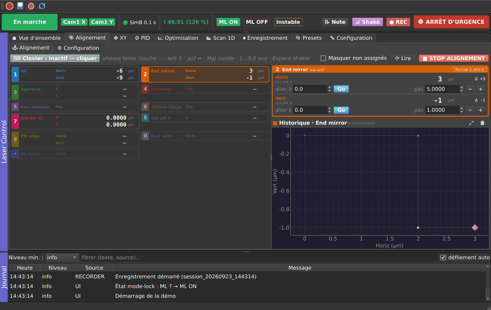

# Laser Control — PyMoDAQ extension

PyMoDAQ dashboard extension to stabilize a mode-locked thin-disk laser with intracavity XUV
generation. It replaces the former extensions (LaserController, XY Stage Controller…) with **a single
extension** (decision D2 of the specification), organized in layers: a core that arbitrates every
access to the hardware, engines in pure logic, and an explicit user interface.

- **Always-visible status bar**: global state, one button per automation, freshness of the data of
  computer B, intensity versus threshold, ML ON / OFF / Unstable, Note, Shake, REC, EMERGENCY STOP.
- **Alignment tab = workstation**: keyboard jog, history, and under the motors one button per chosen
  PID or optimization ("Button in Alignment"): one click starts, another one stops.
- **Other tabs**: Overview (one-click stabilization, one card per motor with owner and envelope), XY,
  PID (several PIDs), Optimization (several named optimizations), 1D Scan, Recording, Presets,
  Configuration.
- **Safety**: the invariants S1–S12 are enforced by the core, not by the user interface, and each one
  has its automatic test.
- **HDF5 recording** (periodic snapshots, bursts around the shake, notes, ML state).
- Versioned **presets**, written with **roles** (OC_H, Cam1_x…): the same preset loads at the office
  and in the lab, only the roles file of the machine changes.
- **LaserSim simulator** (motor and 0D detector plugins) to work at the office.



## Compatibility

- PyMoDAQ **5.1.x** (developed on 5.1.10) and **5.2.x**. Tested with pymodaq 5.1.10 (pymodaq_gui 5.0.32
  and 5.1.12), pymodaq 5.2.11, Python 3.11, PyQt5. The user interface goes through qtpy (PyQt6 and
  PySide6 should work, not tested).
- ⚠ pymodaq 5.1.10 does not start with pymodaq_gui / pymodaq_data / pymodaq_utils 5.2
  (ImportError). Do not upgrade these packages separately from pymodaq.

## Installation

In the PyMoDAQ environment:

```bash
cd pymodaq_plugins_lasercontrol
pip install -e .
```

The version comes from the git tags (`hatch-vcs`, 0.2.0 without a git repository). The extension
appears in the *Extensions* menu of the dashboard as **Laser Control**. The `LaserSim` plugins (motor
and 0D detector) appear in the plugin lists.

Tests (≈ 1 min, off-screen Qt): `pip install pytest`, then `pytest`. The dashboard tests write, then
delete, a preset `lc_pytest_dashboard.xml` in the PyMoDAQ presets folder.

## Getting started at the office (simulator)

```bash
python -m pymodaq_plugins_lasercontrol.tools.sim_preset
python -m pymodaq_plugins_lasercontrol.extensions.laser_control laser_sim
```

The first command writes:

- the dashboard preset `laser_sim` (an *experiment* in PyMoDAQ 5.2): ten simulated motors and the
  `SimB` detector, which plays computer B. If it already exists, `--force` replaces it (needed to get
  the motors of the test benches);
- the simulator roles, added to the roles file of the machine without touching the existing roles,
  with the same names as the lab template (`docs/examples/roles_lab.toml`);
- the Laser Control preset **"Simulator demo"**.

The second one opens the dashboard with this preset and the extension (or: usual dashboard, load
`laser_sim`, then *Extensions → Laser Control*). Then: **Presets → Simulator demo → Load**, then
**▶ Acquisition** in the status bar, and the **Alignment** tab.

Besides the simulated laser, the simulator contains two simple test benches:

| Bench | Motors | Signal | Demo automation |
|---|---|---|---|
| beam pointing | `Steer_H`, `Steer_V` | `Beam_x`, `Beam_y` (µm, 0 = centered) | PIDs "Beam H" and "Beam V" (setpoint 0, Kp 0.6) |
| photodiode behind a pinhole | `PD_X`, `PD_Y` | `PD_current` (mA, 2 mA at best) | "Photodiode optim" (one pass), "Photodiode tracking" (periodic) |
| laser | `OC_H`, `OC_V`… | `Cam1_x`, `Laser_power`… | "Cam1 X ← OC_H", "OC power optim" |

The optima drift slowly (about one minute). Misalign a bench with the keyboard, then click its button.

To simulate failures, use the settings of the `SimB` viewer in the dashboard: noise, drift,
intensity drops (disabled by default), *muted* (computer B silent) and *frozen* (frozen values).

## Commissioning in the lab (computer A)

Start-up order (T2.4): LECO coordinator → computer B (cameras + 0D extension) → single dashboard of
computer A → Laser Control extension.

1. **`config_lasercontrol.toml`**: it is created at the first launch, next to `config_pymodaq.toml`,
   and stays specific to each machine, outside git. Set `[machine] name = "lab"`, the folders, the
   address of the Red Pitaya (`[shaker]`) and the folder shared with computer B (`event_trigger_folder`, O8).
2. **Roles**: in **Configuration → Roles**, click "Create missing roles", then give the roles the same
   names as at the office (template: `docs/examples/roles_lab.toml`), with the unit and the direction of
   each motor. Under "Frame counters", choose the frame counter channel of computer B (O9).
3. **Legacy profiles**: **Presets → Import a legacy profile…** accepts LaserController sessions, PID
   and optimizer profiles (each one becomes a named optimization), and XY profiles. Motors and channels
   become roles. The `max_step`, `max_excursion` and rate limits are not invented: they must be filled in.
4. **PID / Optimization**: give each useful automation a short name ("Optim HA", "Stab. OC_X"…) and
   tick **Button in Alignment**.
5. **Presets → Check on this machine**, test in CW, then **Mark as validated…**

Single launch script: `python -m pymodaq_plugins_lasercontrol.extensions.laser_control <preset>`.

## Where the files are

| File | Default location | Content |
|---|---|---|
| `config_lasercontrol.toml` | PyMoDAQ configuration folder | machine settings (name, folders, shaker…) |
| `roles_<machine>.toml` | `~/.pymodaq/laser_control/` | roles ↔ modules / channels of this machine |
| `presets/*.json` | `~/.pymodaq/laser_control/presets/` | presets (PID, optimizer, safety, alignment, XY, scan, recording) |
| `recordings/YYYY-MM-DD/session_*.h5` | `~/.pymodaq/laser_control/recordings/` | HDF5 recordings |
| `session_<machine>.json` | `~/.pymodaq/laser_control/` | last state of the user interface, restored without starting anything (T6.6) |
| `alignment_history_<machine>.json` | `~/.pymodaq/laser_control/` | position history of the Alignment tab |
| `logs/laser_control.log` | `~/.pymodaq/laser_control/logs/` | technical log (rotating, de-duplicated messages) |

The `presets` folder can point to a shared or versioned folder, to use the same presets on both
machines (`[paths] presets_folder`). Reading a session:
`from pymodaq_plugins_lasercontrol.recording import load_session`.

## Code organization

```
src/pymodaq_plugins_lasercontrol/
├── core/          broker (only access to the hardware), ownership, signals (freshness, heartbeat),
│                  safety (S1–S5), states, roles, events, coordinator (LaserCore), automation
├── engines/       pid, scan (1D, XY snake), optimizer (pluggable interface + 4 algorithms)
├── hardware/      PyMoDAQ ports (DAQ_Move / DAQ_Viewer), simulator, Red Pitaya shaker
├── recording/     snapshots, HDF5 writing in a thread, bursts, trigger files (O8), reading
├── presets/       versioned schema, storage, validation, import of the legacy profiles
├── ui/            status bar, tabs, automation buttons of the Alignment tab (quick_panel), log
├── extensions/    laser_control.py: the PyMoDAQ extension class
├── daq_move_plugins/, daq_viewer_plugins/plugins_0D/   LaserSim plugins
└── tools/         sim_preset.py: simulator preset, its roles and the "Simulator demo" preset
```

The core and the engines depend neither on Qt nor on PyMoDAQ. They are tested with a simulated clock
and simulated hardware (`core/fakes.py`), and the user interface never goes through `modules_manager`.
Details in `docs/design.md`.

## Documentation

- `docs/user_guide.md`: start, load a preset, activate the stabilization, what to do when it is red (T11.1).
- `docs/incident_sheet.md`: crash, computer B silent, intensity at 0, emergency stop (T11.2).
- `docs/design.md`: architecture, invariants and their tests, adding a motor, a detector or an engine (T11.3).
- `docs/pid_tuning.md`: signs, gains, weights, envelopes (T11.4).
- `CHANGELOG.md`.

## Progress with respect to the specification

| Work package | Status |
|---|---|
| L0 | Replaced by the redesign: each fix is covered by the new core (emergency stop through `stop_motion`, pause and resume of the PIDs, NaN instead of 0.0, intensity guard, no more reconnection of the detectors, nothing blocking). |
| L1 | Done: structure, roles, simulator, 71 tests, version and git hash in the UI and in the recordings, rotating log. To do on your side: branches and tags (T1.5), NTP (T1.7). The simulator must be calibrated against real measurements (T9.1). |
| L2 | Alignment and XY are in the extension, behind the motor ownership (T2.3). The hardware inventory, the single lab preset and the removal of the old dashboard remain to be done in the lab. |
| L3, L4 | Done: broker, freshness and heartbeat, ownership (D4 / D5 / O3-A), S1–S5 supervisor, state machine, event bus, emergency stop; multiple PIDs, passive monitor, 1D scan, optimizer interface with the 4 historical modes. |
| L5 | Done. Readability from a remote access and on a small screen remains to be checked on site (T5.9, T8.2). |
| L6 | Done, except the differences between presets (T6.5, P3). |
| L7 | Done on computer A. On computer B (T7.6): read the trigger files and save the images. |
| L9 | Session loader (T9.2). The rest is to be done. |
| L10 | Only the interface is ready (`register_algorithm`). |
| L11 | User guide, incident sheet, design, PID tuning. |
| L12 | Invariants, arbitrations and some of the failures tested in simulation. Endurance, CW, ML and "non-developer user" test: in the lab. |

## Points to check in the lab

- **Heartbeat (O9)**: without a frame counter channel, the freshness relies on the reception time
  (option O9-B). A value that is frozen but still sent is then not detected. The counter must be added
  on computer B.
- **Motor units**: the safety limits are in the unit of the PyMoDAQ module (picomotor steps, mm…).
  Also fill in the *Resolution* (smallest meaningful step).
- **`limit` jog mode** (Alignment): a `move_abs` towards Min/Max may continue on the controller if
  PyMoDAQ crashes (S10). Prefer `step`, or `native` if the motor plugin implements `jog()`.
- **Isolated spikes**: no outlier filter. A spike produces at most one bounded step (S3), inside the
  envelope (S4). A deadband and a 0.5 s period limit its effect.
- **Shake**: the Red Pitaya script `redpitaya_scpi.py` must be importable, or copied into
  `~/.pymodaq/laser_control/`.
- **PyMoDAQ 5.2**: the module list is read again when the experiment changes. Stop the automations first.

License: MIT (see `LICENSE`).
