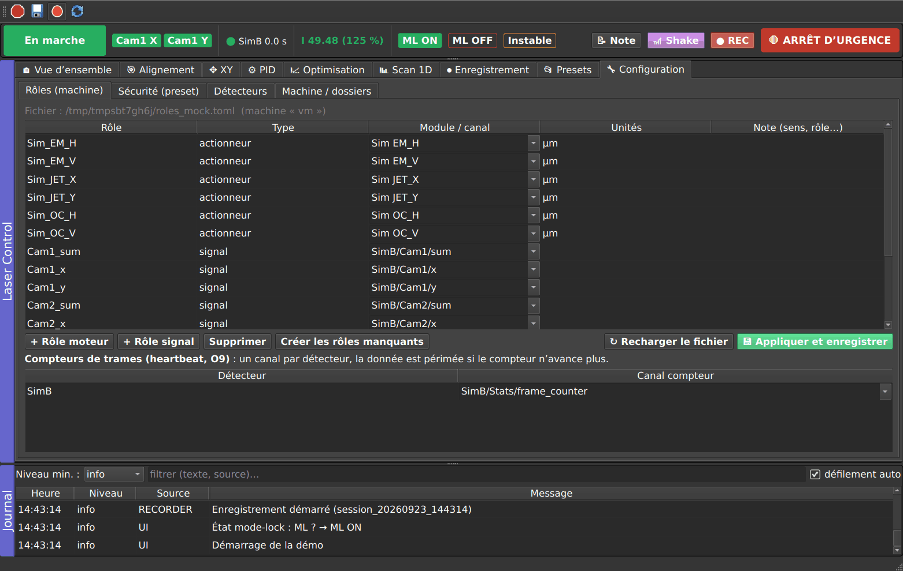

# Design document — Laser Control (T11.3)

## 1. Overview

```
PyMoDAQ dashboard (computer A): DAQ_Move of every motor, LECO DAQ_Viewer of computer B, power…
        │  (read-only access to modules_manager, once: hardware/pymodaq_ports.discover_ports)
        ▼
hardware/pymodaq_ports.py   DAQMovePort / DAQViewerPort: Qt ↔ ports adapters
        │  ports (core/ports.py): move_rel, move_abs, stop, position, frames {channel: value}
        ▼
core/ ─ LaserCore (coordinator.py) ─────────────────────────────────────────────────────────┐
  broker.py      only access to the hardware: orders, end of move, timeouts, external moves     │
  signals.py     last value of each 0D channel, age, frame counter (O9), NaN = invalid          │
  ownership.py   one owner per motor (Human, PID:x, OPT:x, SCAN…), preemption D4 / D5           │
  safety.py      S1–S5: freshness, intensity guard, bounded steps, envelope, rate, abs limits  │
  states.py      states per automation (OFF, ARMED, ACTIVE, PAUSED, HELD, ERROR) and global     │
  roles.py       logical roles ↔ modules / channels of the machine (TOML)                        │
  events.py      timestamped event bus (log, recording, UI)                                     │
  automation.py  base class of the automations                                                  │
└───────────────────────────────────────────────────────────────────────────────────────────┘
        ▲ request_moves(), signals.value()          ▲ events
engines/  PIDAutomation, OptimizerAutomation (+ pluggable algorithms), Scan1D, XYScan: pure logic
recording/ Recorder (snapshots, bursts, pre-event buffer), H5Writer (thread), triggers (O8)
presets/  versioned schema, JSON store, validation per machine, import of the legacy profiles
ui/       LaserControlApp + tabs; the widgets only talk to the core and to ManualControl
          quick_panel.py: automation buttons under the motors of the Alignment tab
extensions/laser_control.py   CustomExt class (PyMoDAQ 5.1 and 5.2)
```

**Execution model (O2-A)**: everything runs in the GUI thread. A 20 Hz `QTimer` calls
`LaserCore.tick()` (timeouts, safety checks, automation steps). The user interface refreshes at 5 Hz
at most. Orders are never blocking: `move_rel` on the module, then end of move through
`move_done_signal`. Only the HDF5 writing runs in a thread, behind a queue.

**Golden rule**: the engines and the UI never touch `modules_manager`. Everything goes through the
core. Only `hardware/pymodaq_ports.py`, the extension, the LaserSim plugins and the
`tools/sim_preset.py` tool import `pymodaq`. The UI only uses `pymodaq_gui` (ParameterTree, docks).
The core and the engines depend neither on Qt nor on PyMoDAQ. They are tested with a simulated clock
(`core/clock.FakeClock`) and simulated ports (`core/fakes.py`).

## 2. Life cycle of an automation

```
OFF ──start(): validation──► ARMED ──engagement──► ACTIVE ──stop()──► OFF
 ▲          │ refused (reason in the log)            │
 └──────────┘                                        ├── S1–S5 violation / timeout ──► HELD ── manual resume() (O10-A) ──► ACTIVE
                                                     ├── D4 preemption ──► PAUSED ── motors released: auto resume (O3-A) ──► ACTIVE
                                                     └── exception ──► ERROR (S8)
```

- `start()`: validation (roles resolved, modules present and initialized, positions known, fresh
  data, complete safety limits, intensity guard), then storage of the engagement positions (S4
  envelope), capture of the intensity reference if needed, and the motors are taken.
- D4 preemption: the last activated one takes the shared motors. The previous one goes PAUSED
  ("preempted") and resumes by itself when they are released. Its integral is then reset.
- Human action (D5 / S7): `human_preempt()` stops (OFF) every owning automation **before** the human
  order is sent. A move started outside the extension is detected too (`on_external_move`).
- HELD: no order is sent, the integral is frozen, the automation keeps its motors and its envelope
  reference. The resume is manual and checks the data, the intensity and the positions again.

## 3. Invariants and where they are enforced

| ID | Enforced by | Tests |
|---|---|---|
| S1 fresh data | `SignalSource.freshness` and `all_fresh` (age ≤ `max_data_age_s`, frame counter advancing); checked at each tick and at each `request_moves` | `test_S1_stale_data_freezes`, `test_S1_frozen_heartbeat_is_stale`, `test_viewer_port_channels_and_mute` |
| S2 intensity | `IntensityGuard` (relative or absolute threshold, hysteresis; reference = intensity at engagement, never zero) | `test_S2_*` |
| S3 bounded steps | `SafetySupervisor.check_move`: `max_step` of the role on top of the max step of the engine; automations only have `move_rel` | `test_S3_only_bounded_relative_steps`, `test_pid_signs_and_clamp_after_weighting` |
| S4 envelope | `safety.engage` and `allowed_range`: ± `max_excursion` around the engagement ∩ [`abs_min`, `abs_max`]; at the edge, step clipped then hold | `test_S4_envelope_clamps_and_freezes`, `test_S4_absolute_limits` |
| S5 rate | `RateTracker`: cumulated displacement over a sliding window | `test_S5_rate_limit_freezes` |
| S6 one owner | `Ownership`; `request_moves` refuses a non-owner | `test_S6_*` |
| S7 human = preemption | `LaserCore.human_preempt` called by the broker before any manual order | `test_S7_*`, `test_D5_external_move_detected`, `test_04_alignment_keyboard_preempts_pid` |
| S8 exception = hold | `tick()` catches the exception: ERROR state, a single event | `test_S8_exception_freezes_once` |
| S9 nothing starts by itself | no `start()` outside an explicit action; preset and session only configure | `test_S9_nothing_starts_by_itself`, `test_01_…`, `test_07_…` |
| S10 crash = no motion | no order queue; a busy motor does not receive another one; `limit` flagged in the UI | `test_S10_no_order_stacked_on_busy_motor` |
| S11 emergency stop | `emergency_stop`: automations stopped, then `stop_motion` on **every** module of the dashboard, latched state | `test_S11_estop_stops_everything_and_latches`, `test_08_estop_and_close`, `test_roles_move_and_estop` |
| S12 no misleading 0.0 | `extract_scalars` and `data_to_float` return NaN or None; NaN = invalid data | `test_S12_*` |

Arbitrations (T12.3): `test_S6_single_owner_and_O3_pause_resume`,
`test_optimizer_pass_pauses_pid_then_pid_resumes`, `test_xyscan_visits_pattern_and_stops_on_human_action`.
Move timeout: `test_move_timeout_holds`. The tests `test_pymodaq_ports.py`, `test_extension_ui.py` and
`test_dashboard_integration.py` use real DAQ_Move and DAQ_Viewer (LaserSim plugins), up to the loading
by the PyMoDAQ dashboard itself.

## 4. Roles, presets, recording

- **Roles** (`core/roles.py`): `roles_<machine>.toml`, with `[actuators.X] module=…`,
  `[signals.Y] channel="Detector/data/label"` and `[heartbeats] Detector = channel`. Presets only
  reference roles. Validating a preset on a machine lists the missing roles, and only the matching
  automation is blocked.
- **Presets** (`presets/schema.py`): JSON with `schema_version`, name, description, status (draft /
  validated, date, author, comment), conditions, PIDs (`pids`), optimizations (`optimizers`, a list
  since schema 2), safety, alignment, XY, scan, recording, curves. `migrate()` upgrades the old
  versions (schema 1 → 2: the single optimizer becomes the "Optimizer" optimization). Each PID and
  optimization has a `label` (short name), `show_in_alignment` and, for an optimization,
  `button_action` (`single`, `periodic`, `full`). The content hash is stored at validation: a
  validated preset whose content changed goes back to draft.
- **Recording** (`recording/`): one HDF5 file per session (rotation by size and by duration). Each
  snapshot contains **every** role, every motor (read and commanded position), every received channel
  (option), the internal variables of each automation (`Automation.variables()`), the safety state,
  the ML state, the preset and its hash. Events are in a separate table. The circular pre-event buffer
  and the bursts are attached to an `event_id`. Reading: `recording.load_session()`.

**Alignment buttons** (`ui/quick_panel.py`): `LaserControlApp.quick_items()` lists the ticked
automations (order of the PID then Optimization tabs), `quick_click(id)` performs the action of a click
(OFF → `start`, HELD → `resume`, otherwise `stop`) with the current settings of the tab. Nothing more:
refusals come from the same core checks (`validate`, safety, emergency stop) and are published in the
log. `AlignmentWidget.set_bottom_panel()` places the panel under the cards; the alignment widget itself
still only knows `ManualControl`.

## 5. Adding a motor



No code to write:

1. Add the module (DAQ_Move) to the dashboard preset. The plugin must implement `move_rel`,
   `stop_motion` and `move_done`. `jog(direction, speed)` is optional and enables the `native` mode of
   the Alignment tab.
2. In the extension, click **Reload hardware** (toolbar), or restart.
3. **Configuration → Roles**: create the role (name, module, unit, direction note), then
   **Apply and save**.
4. **Configuration → Safety**: `max_step`, `max_excursion`, `rate_max`, and if needed `abs_min` /
   `abs_max` and the resolution. Without them, no automation can drive this motor.
5. The motor appears in the Overview, in the lists of the PIDs, optimizations and scans, and in the
   recording.

## 6. Adding a detector or a 0D quantity (O7)

1. Add the DAQ_Viewer to the dashboard (0D, or any viewer whose data contain scalars).
2. **Reload hardware**, start the acquisition (**▶ Acquisition** or Configuration → Detectors).
3. Configuration → Detectors → "Received 0D channels" gives the keys `Detector/data/label`. Declare the
   signal roles (Configuration → Roles), and the frame counter if there is one.
4. The new signal is recorded automatically (T7.1) and becomes usable by the PIDs, the optimizer, the
   scans and the curves.

## 7. Adding an engine (automation)

Subclass `core.automation.Automation` in `engines/`:

```python
class MyEngine(Automation):
    kind = 'my_engine'

    def __init__(self, motor_role, signal_role):
        super().__init__('MINE:1', 'My engine')
        self.motor_role, self.signal_role = motor_role, signal_role
        self.period_s = 0.5

    def motor_roles(self):  return [self.motor_role]        # ownership + safety
    def signal_roles(self): return [self.signal_role]       # freshness required (S1)
    def policy(self):       return SafetyPolicy()           # S1, S2, S5 and S4 envelope by default

    def tick(self, core, now):                              # called every period_s when ACTIVE
        v = core.signals.value(core.roles.channel_for(self.signal_role))
        if not math.isfinite(v):
            return                                          # S12: never move on NaN
        core.request_moves(self, {self.motor_role: -0.1 * v})   # relative step, checked by the core

    def variables(self):                                    # recorded in each snapshot
        return {'last_value': ...}
```

- Never block in `tick()`, never call a PyMoDAQ module. `request_moves` returns the steps actually
  sent: a motor that is still busy does not receive any, and the engine retries at the next tick.
- The hooks `validate`, `on_start` (error message = refusal), `on_stop`, `on_pause`, `on_resume` and
  `on_hold` are available. `is_done()` signals the end, and the core then stops the automation.
- The core adds the automation with `core.add_automation()`. It appears in the status bar (when
  engaged) and in the log, and it is recorded. To give it a button in the Alignment tab, its tab
  provides `quick_items()` and `config_of()` (see `pid_tab.py`), and `quick_click` knows how to start it.

### Adding an optimization algorithm (L10)

Implement `start(ctx)`, `propose()` and `observe(result)` (`engines/optimizer/base.py`), or write a
generator that `yield`s `Measure`, `MoveTo`, `Report` and `Status`. Register it with
`register_algorithm('name', 'Label', factory)`. It appears in the "Mode" list. The driver
(`OptimizerAutomation`) converts the offsets into bounded, checked steps, and averages fresh frames
for each measurement.

## 8. PyMoDAQ 5.1 / 5.2 compatibility

- 5.1: the dashboard creates the extension with `klass(area, dashboard=self)`. 5.2: with
  `create_extension(dashboard, klass)`, in a `SharedUI` window, and requires the `show_dashboard`
  action (added by `create_dashboard_toolbar`).
- Both `CustomApp` APIs are provided (`setup_docks` and `setup_docks_and_widgets`, `setup_menu` and
  `setup_menus_and_toolbars`).
- Settings of the motor module: `move_settings` (5.1) or `actuator_settings` (5.2).
- A `move_abs` to the current position produces no `move_done` in 5.1. The broker therefore does not
  send this null move ("already in position").
- In 5.2, an experiment change calls `do_things_after_experiment_set`, which reloads the hardware.
