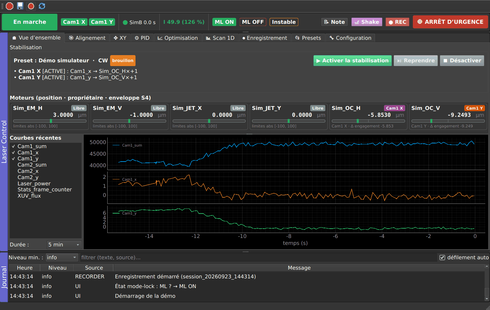
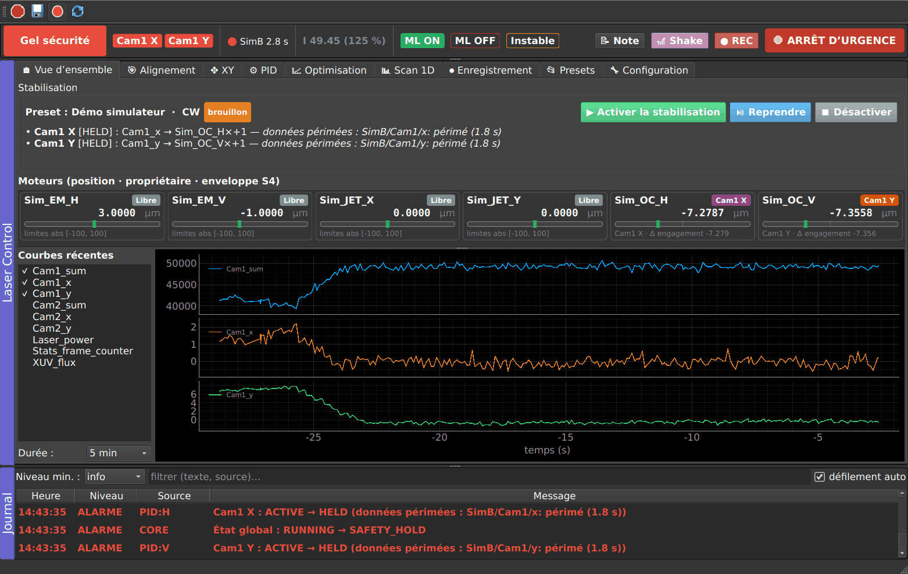

# Guide utilisateur — Laser Control (T11.1)

## 1. Démarrer

1. Coordinateur LECO, puis ordi B (caméras et extension 0D en acquisition).
2. Ordi A : dashboard PyMoDAQ avec le preset du labo, puis *Extensions → Laser Control*
   (ou `python -m pymodaq_plugins_lasercontrol.extensions.laser_control <preset>`).
3. Rien ne démarre seul (S9). La barre du haut indique **Repos**.
4. Si le bouton **▶ Acquisition** apparaît dans la barre d'état, un détecteur utilisé par les rôles
   n'est pas en acquisition : cliquer dessus.

## 2. Lire la barre d'état (toujours visible)

| Élément | Signification |
|---|---|
| Grand badge à gauche | **Repos** (rien d'engagé) · **En marche** · **Gel sécurité** (un automatisme est gelé) · **ARRÊT D'URGENCE** · **Erreur** |
| Boutons d'automatismes | un par PID, l'optimiseur, les scans. Couleur = état. Un clic ouvre l'onglet concerné. |
| Voyant détecteur (ex. `LECO_B 0.3 s`) | âge de la dernière trame : vert = frais, orange = en retard, rouge = périmé (les automatismes gèlent). |
| `I …` | intensité (garde S2) et % de la référence : vert = au-dessus du seuil, rouge = sous le seuil (gel), gris = inconnue. « garde DÉSACTIVÉE » en orange si la garde est coupée dans la configuration. |
| ML ON / ML OFF / Instable | état du mode-lock, **à cliquer par vous** : il est horodaté et enregistré. |
| 📝 Note | texte libre horodaté (journal + enregistrement). |
| 🎢 Shake | tir du shaker piézo, avec une rafale d'enregistrement si REC est actif. |
| ● REC | enregistrement HDF5 en cours ou non. |
| ARRÊT D'URGENCE (F12 ou Pause) | arrête tous les automatismes puis tous les moteurs. Ensuite **Réarmer**. |

Le **journal**, en bas, liste tous les événements (démarrages, préemptions, sécurités…). Les alarmes y
apparaissent en rouge.

## 3. Charger un preset

**Presets** : choisir un preset (les presets **validés** sont en tête), puis **Charger**. Le chargement
ne démarre rien. Si un rôle ou un canal manque sur cette machine, un avertissement l'indique et
l'automatisme concerné ne pourra pas être activé. **Vérifier sur cette machine** refait le contrôle.

## 4. Activer / désactiver la stabilisation

**Vue d'ensemble** :

- le résumé liste les PID de stabilisation, le signal suivi et les moteurs pilotés ;
- **Activer la stabilisation** : un résumé de ce qui va bouger (moteurs et limites) s'affiche, puis on
  confirme. C'est **tout ou rien** : si un PID ne peut pas démarrer, aucun ne démarre, et la raison
  s'affiche en rouge sous le résumé ;
- **Désactiver** : arrête les PID de stabilisation. Les moteurs restent où ils sont ;
- **Reprendre** : relance les PID gelés par une sécurité, une fois la cause disparue (voir 5).

Les cartes des moteurs montrent la position, le **propriétaire** (Libre, Humain, nom du PID,
Optimiseur, Scan) et la jauge d'**enveloppe** (vert, puis orange, puis rouge près du bord).

**Bouger un moteur à la main** (Alignement, XY, Go, positions mémorisées) **arrête d'abord**
l'automatisme qui le possède. Le journal l'indique : « Cam1 X : ACTIVE → OFF (action manuelle sur
OC_H (alignement)) ». Un mouvement lancé depuis le module PyMoDAQ lui-même, hors de l'extension, est
détecté et arrête aussi l'automatisme (« mouvement externe détecté »).

## 5. Que faire si c'est rouge

| Ce que je vois | Cause probable | Quoi faire |
|---|---|---|
| **Gel sécurité**, PID en *Gelé (sécurité)*, raison « données périmées » | ordi B muet, LECO coupé, acquisition arrêtée | vérifier l'ordi B et le voyant détecteur (▶ Acquisition si besoin). Quand il est vert : **Reprendre**. |
| raison « … compteur de trames figé » | l'ordi B envoie encore, mais son compteur n'avance plus | redémarrer l'acquisition ou l'extension de l'ordi B, puis **Reprendre**. |
| raison « intensité sous le seuil » ou « intensité inconnue » | laser éteint, mode-lock perdu, pompe réduite, mesure de puissance absente | rétablir le laser ou la mesure. **Reprendre** n'est possible qu'au-dessus du seuil plus l'hystérésis. |
| raison « enveloppe atteinte sur … » | le PID pousse un moteur au bord de son excursion : dérive trop grande, mauvais signe ou mauvais gain | ne pas reprendre en aveugle. Recentrer à la main si nécessaire, vérifier le signe (voir `reglage_pid.md`), puis **Nouvelle référence d'enveloppe** ou relancer. |
| raison « limite de débit atteinte sur … » | trop de déplacement cumulé sur la fenêtre (60 s par défaut) | idem : chercher pourquoi le PID pousse autant. |
| raison « délai dépassé sur … » | moteur ou contrôleur qui ne répond plus | vérifier le contrôleur dans le dashboard. |
| raison « limites de sécurité non définies pour … » | limites du moteur absentes du preset | Configuration → Sécurité : les renseigner, enregistrer le preset. |
| automatisme en **Erreur** | exception dans le calcul (S8) | lire le journal, puis relancer. Si ça recommence, signaler le message. |
| **ARRÊT D'URGENCE** | vous (ou F12 / Pause) | quand la situation est sûre : **Réarmer**, puis relancer ce qu'il faut. |

En cas de doute, **Désactiver** : rien ne bouge. Pour tout incident sérieux, voir `fiche_incident.md`.

## 6. Enregistrer et annoter

- **● REC** démarre une session HDF5 : un snapshot périodique et des rafales autour des événements
  choisis dans l'onglet Enregistrement.
- Cliquez **ML ON / ML OFF / Instable** à chaque changement du mode-lock et ajoutez des **Notes** :
  c'est ce qui rend les enregistrements exploitables.

## 7. Raccourcis

| Où | Touches |
|---|---|
| partout | **F12** ou **Pause** : arrêt d'urgence |
| Alignement (cliquer sur « Clavier ») | `a`/`d` horizontal, `s`/`w` vertical, **Maj** rapide, `1`…`9`, `0` choix de l'axe, **Espace** shake |
| XY | `a`/`d` X, `s`/`w` Y, **Maj** ×10, **Espace** shake, `T` / `Maj+T` groupe suivant / précédent |
