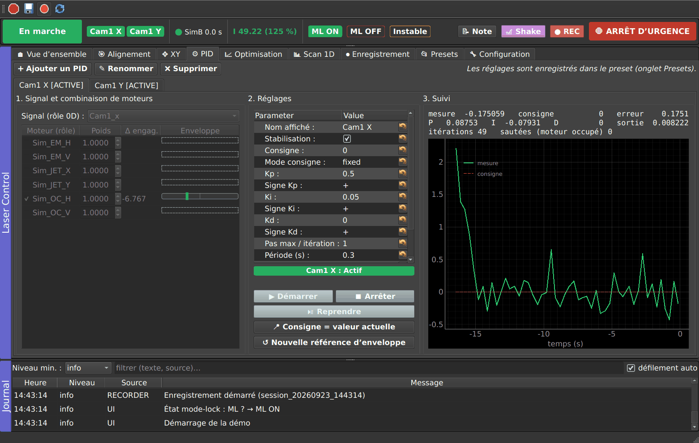

# Guide de réglage des PID — Laser Control (T11.4)

Un PID régule **un signal 0D** (par ex. `Cam1_x`, un centroïde en pixels) en déplaçant **une
combinaison de moteurs** (par ex. `OC_H` avec un poids 1). À chaque période (0.5 s = 2 Hz) :

```
erreur = consigne − mesure
sortie = Kp·erreur + Ki·∫erreur·dt + Kd·d(mesure)/dt          (chaque terme avec son signe + / −)
pas du moteur i = sortie × poids_i, borné à ± « Pas max / itération », puis à ± max_step du rôle (S3)
```

- Il faut une **mesure fraîche** à chaque itération (S1). Une mesure déjà utilisée n'est pas réutilisée.
- Si un moteur bouge encore, l'itération est **sautée** : pas d'empilement d'ordres.
- **Bande morte** : si |erreur| est plus petite, rien ne bouge et l'intégrale est gelée.
- **Anti-windup** : |Ki·intégrale| reste inférieur ou égal au pas max. L'intégrale est remise à zéro à
  chaque reprise (pause, gel).
- Le terme D porte sur la mesure et non sur l'erreur : changer la consigne ne provoque pas de coup.



## 1. Trouver le signe (le plus important)

Un signe faux fait **diverger** la boucle : le moteur part toujours du mauvais côté. L'enveloppe (S4)
et le débit (S5) limitent les dégâts, puis gèlent le PID.

1. Dans l'onglet **Alignement**, faire un petit pas `+` sur le moteur et regarder le signal : augmente-t-il
   ou diminue-t-il ?
2. Si un pas `+` fait **augmenter** le signal, alors pour corriger une erreur positive (mesure trop
   basse) il faut un pas positif : **Signe Kp = +** et poids positif.
3. Si un pas `+` fait **diminuer** le signal : **Signe Kp = −**, ou un poids négatif. Choisir l'un ou
   l'autre, pas les deux.
4. Mêmes signes pour Ki et Kd.
5. Écrire le sens dans la note du rôle (Configuration → Rôles), par exemple « + = faisceau vers la
   droite sur Cam1 ».

## 2. Gains typiques

Commencer en **P seul**, faible, avec **Confirmer chaque mvt** coché : chaque pas est proposé avant
d'être envoyé, et le PID est en pause pendant la question.

| Paramètre | Point de départ | Remarque |
|---|---|---|
| Période | 0.5 s | plus court que le temps de réponse de la caméra, c'est inutile |
| Kp | 0.05 – 0.5 (unités moteur / unité signal) | partir de ~ 0.3 × (1 / sensibilité), la sensibilité étant la variation du signal pour un pas de 1 |
| Ki | 0 au début, puis ~ Kp / 20 s⁻¹ | l'intégrale compense la dérive thermique lente (~ 1 min) |
| Kd | 0 | avec un signal bruité à 2 Hz, le D amplifie surtout le bruit |
| Bande morte | ~ 2 × l'écart-type du bruit du signal | évite de « chasser » le bruit |
| Pas max / itération | quelques pas du moteur | borne chaque correction |
| Attente après mvt | 0 à 0.5 s | si la caméra intègre encore l'ancienne position |

Procédure : P seul avec confirmation, puis P sans confirmation. On augmente Kp jusqu'à une légère
oscillation, et on le divise par deux. On ajoute ensuite Ki jusqu'à suivre la dérive sans osciller.
Dans l'onglet PID, la courbe mesure / consigne et les contributions P, I, D sont affichées en direct.

## 3. Poids (plusieurs moteurs pour un signal)

- La sortie du PID est multipliée par le poids de chaque moteur coché. Avec `OC_H × 1` et `EM_H × −0.5`,
  un pas de +1 sur OC_H s'accompagne de −0.5 sur EM_H.
- Le pas max s'applique **après** pondération, moteur par moteur.
- Deux PID ne doivent pas piloter le même moteur en même temps (D4 : le dernier activé prend la main,
  l'autre passe en pause).

## 4. Enveloppes et limites (Configuration → Sécurité)

| Limite | Rôle | Conseil |
|---|---|---|
| Pas max (S3) | plus grand pas d'un ordre automatique | quelques pas : une correction, pas un réalignement |
| Excursion max (S4) | ± autour de la position au moment de l'engagement | un peu plus que la dérive attendue sur une session. Trop grand : un signe faux va loin. Trop petit : gels fréquents. |
| Abs min / max | limites absolues, aussi pour le manuel si coché | butées mécaniques ou zones interdites |
| Débit max (S5) sur la fenêtre | déplacement cumulé maximal sur 60 s par défaut | 2 à 5 fois la dérive normale sur la fenêtre |
| Résolution | plus petit pas significatif | les pas plus petits ne sont pas envoyés |

Garde intensité (S2) : seuil relatif (fraction de la référence prise à l'engagement) ou absolu, avec
hystérésis. Un seuil relatif de 0.5 avec une hystérésis de 0.1 gèle sous 50 % et n'autorise la reprise
qu'au-dessus de 60 %.

Quand un PID est gelé sur « enveloppe atteinte », le moteur est au bord de ce qui était autorisé.
Si la nouvelle position est bonne, **Nouvelle référence d'enveloppe** recentre l'enveloppe sur les
positions actuelles.

## 5. Consigne

- **fixed** : valeur saisie. **Consigne = valeur actuelle** la remplit avec la dernière mesure.
- **capture** : la consigne prend la valeur mesurée à chaque démarrage (pratique pour « garder le
  faisceau où il est »).

## 6. Vérifier au simulateur avant le labo

Au bureau (`python -m pymodaq_plugins_lasercontrol.tools.sim_preset`), les rôles `Cam1_x` / `OC_H` et
`Cam1_y` / `OC_V` du simulateur se règlent comme au labo : dérive d'environ une minute, bruit, couplages
entre axes. Un preset qui converge au simulateur n'est pas forcément bon au labo, mais un preset qui
diverge au simulateur a presque sûrement un problème de signe ou de gain.
